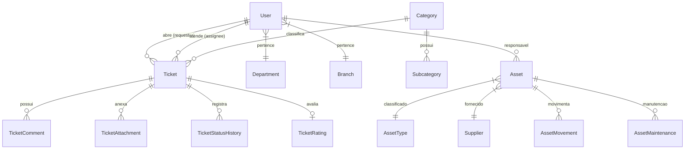

# 🚀 AgroDesk TI — Documentação Técnica e Funcional Completa (Master Documentation)

> **Documento Completo de Especificação Técnica, Arquitetura, Regras de Negócio e Funcionalidades**  
> *Destinado a análises de engenharia de software, modelos de inteligência artificial, criação de estratégias de conteúdo, apresentações executivas e cases de portfólio (LinkedIn).*

---

## 📋 Sumário Executivo

O **AgroDesk TI** é um sistema completo e moderno de **Help Desk, Gestão de Ordens de Serviço (OS), Atendimentos de TI e Controle Patrimonial/Ativos**, desenvolvido sob medida para empresas com múltiplas unidades (filiais, lojas, centros de distribuição e unidades de campo), com foco especial em ambientes de agronegócio e varejo corporativo.

A plataforma resolve a descentralização do suporte técnico de TI, eliminando chamados perdidos em mensagens informais, garantindo controle rigoroso de SLA (Service Level Agreement), auditabilidade total de processos, comunicação automatizada com o solicitante via WhatsApp e gestão completa do ciclo de vida dos equipamentos da empresa.

---

## 🛠️ 1. Arquitetura do Sistema e Stack Tecnológica

O projeto foi construído utilizando arquitetura monorepo moderna, separando de forma clara e limpa as responsabilidades entre **Backend API (NestJS)** e **Frontend SPA (React + Vite)**.

```
agrodesk-harmony/
├── backend/                  # API RESTful NestJS + Prisma ORM + PostgreSQL
│   ├── prisma/               # Schema do banco de dados, migrações e scripts de seed
│   ├── src/
│   │   ├── common/           # Interfaces, utils, guards e interceptors globais
│   │   ├── infra/            # Conexão com banco (PrismaService) e utilitários
│   │   └── modules/          # Módulos de negócio (Auth, Users, Tickets, Assets, etc.)
├── src/                      # Frontend SPA React 18 + Vite + TanStack Router
│   ├── components/           # UI Components (Radix UI / Shadcn / Design System)
│   ├── routes/               # Rotas baseadas em arquivo do TanStack Router
│   ├── services/             # Clientes de API Axios e mapeadores de dados
│   ├── lib/                  # Formatadores, máscaras, validações Zod e Store global
│   └── types/                # Interfaces TypeScript unificadas
```

### 1.1 Backend Stack
- **Runtime & Framework:** Node.js v24+ com **NestJS 10** (TypeScript).
- **ORM & Banco de Dados:** **Prisma ORM 5** com **PostgreSQL 15+**.
- **Autenticação & Segurança:** JWT (JSON Web Tokens) com estratégia de Access Token (`15m`) e Refresh Token (`7d`) persistido e revogável no banco. Senhas criptografadas com **Bcrypt** (10 rounds).
- **Validação & DTOs:** `class-validator` e `class-transformer` com sanitização e Pipes globais do NestJS.
- **Documentação de API:** Swagger OpenAPI 3.0 disponível em `/api/docs`.
- **Auditoria:** Módulo nativo de log de auditoria capturando entidade, ação, estado anterior, estado posterior, usuário, IP e User-Agent.

### 1.2 Frontend Stack
- **Biblioteca Core:** **React 18** com TypeScript estrito.
- **Bundler & Build Tool:** **Vite 7** com Hot Module Replacement (HMR) ultra-rápido.
- **Roteamento:** **TanStack Router** (File-based Routing com verificação de tipos em tempo de compilação).
- **Gerenciamento de Estado & Data Fetching:** **TanStack Query (React Query v5)** para cache reativo e otimista de dados + Context Store global com persistência local.
- **Estilização & Design System:**
  - **Vanilla CSS + TailwindCSS** adaptado com design tokens modernos.
  - Paleta de cores baseada na escala **OKLCH** (Verde Esmeralda Corporativo, Dark Slate, Glassmorphism).
  - Suporte completo a **Modo Claro (Light Mode)** e **Modo Escuro (Dark Mode)** com alternância em tempo real.
  - Tipografia moderna (Inter / System UI) e ícones da biblioteca **Lucide React**.
  - Notificações reativas usando **Sonner Toasts** e efeito sonoro opcional para chegada de novas OS.

---

## 🗄️ 2. Modelo de Dados e Esquema do Banco de Dados (Prisma Schema)

O esquema do banco foi projetado para alta integridade referencial, indexação otimizada para consultas de alta frequência e auditoria histórica.



### 2.1 Principais Entidades e Campos

#### A. Usuários (`User`)
- `id`: Unique CUID (`String`).
- `name`: Nome Completo do Usuário (ex: *Victor Moraes*).
- `username`: Nome de Usuário exclusivo usado para login (`String @unique`). Ex: *Victor*.
- `email`: E-mail corporativo opcional (`String? @unique`).
- `passwordHash`: Hash Bcrypt da senha.
- `role`: Perfil de acesso (`SOLICITANTE` ou `TI_ADMIN`).
- `phone`: Telefone principal com máscara automática `(XX) XXXXX-XXXX`.
- `whatsapp`: WhatsApp para envio automático de notificações.
- `extension`: Ramal interno de telefonia.
- `position`: Cargo / Função na empresa.
- `departmentId`: Relacionamento com o Setor.
- `branchId`: Relacionamento com a Filial/Localidade.
- `isActive`: Flag booleana de conta ativa/inativa.
- `mustChangePassword`: Obriga a troca de senha no primeiro login.
- `canReceiveTickets`: Flag que define se o administrador de TI pode receber atribuição direta de OS.

#### B. Filiais e Locais (`Branch`)
- `id`: CUID.
- `name`: Nome da Unidade (ex: *Loja 1 - Matriz*, *Loja 2 - Filial Centro*, *Loja 5 - Distribuição*).
- `address`: Endereço físico completo.
- `description`: Descrição operacional.
- `isActive`: Status de funcionamento.

#### C. Setores e Departamentos (`Department`)
- Contém 18 setores empresariais padronizados: *TI, Gerência, Financeiro, Administrativo, Recursos Humanos, Comercial, Vendas, Operações, Logística, Estoque, Expedição, Faturamento, Compras, Manutenção, Jurídico, Diretoria, Campo, Loja*.

#### D. Categorias e SLAs (`Category` & `Subcategory`)
- `name`: Nome da Categoria (ex: *Computador / Notebook, Impressora, Internet / Rede, Sistema ERP, E-mail, Balança, Telefonia, Câmeras*).
- `defaultSlaHours`: Tempo de SLA em horas (ex: 6h, 8h, 12h, 24h, 48h, 72h).
- `defaultPriority`: Prioridade padrão (`BAIXA`, `MEDIA`, `ALTA`, `CRITICA`).
- `subcategories`: Subtipos específicos (ex: *Não liga, Lentidão, Atolamento de papel, Sem conexão Wi-Fi*).

#### E. Ordem de Serviço / Chamado (`Ticket`)
- `protocol`: Protocolo único sequencial e formatado por ano (ex: `OS-2026-00102`).
- `title`: Título resumido da solicitação.
- `description`: Detalhamento completo do problema relatado.
- `status`: Estado atual da OS em 9 fases:
  - `ABERTO`: Registrada, aguardando triagem.
  - `EM_ANALISE`: Em diagnóstico técnico inicial.
  - `EM_ATENDIMENTO`: Em execução por um técnico de TI.
  - `AGUARDANDO_USUARIO`: Pendente de retorno/dados do solicitante.
  - `AGUARDANDO_PECA`: Aguardando peça de reposição ou terceiro.
  - `RESOLVIDO`: Atendimento concluído e solução aplicada.
  - `FINALIZADO`: Encerrado definitivamente.
  - `CANCELADO`: Solicitado cancelamento ou duplicidade.
  - `REABERTO`: Reaberto para novos ajustes técnicos.
- `priority`: Nível de urgência real (`BAIXA`, `MEDIA`, `ALTA`, `CRITICA`).
- `slaHours`: Horas totais permitidas para o SLA.
- `diagnosis`, `rootCause`, `solution`, `partsUsed`: Campos de laudo técnico preenchidos pela TI.
- `closedAt`: Data/hora de conclusão da OS.

#### F. Módulo Patrimonial / Ativos (`Asset`, `AssetType`, `Supplier`, `AssetMovement`, `AssetMaintenance`)
- Controle individualizado de equipamentos de TI por número de patrimônio (Tag).
- Histórico completo de movimentação entre filiais/setores e log de manutenções com custos e fornecedores.

---

## 🔑 3. Módulos Funcionais e Regras de Negócio

### 3.1 Fluxo de Autenticação e Segurança
1. **Login Inteligente:** O usuário faz login digitando seu `Nome de Usuário` + `Senha`. Não exige digitação de e-mail.
2. **Troca de Senha Obrigatória no Primeiro Acesso:** Contas criadas por administradores possuem a flag `mustChangePassword = true`. No login, o usuário é redirecionado para a tela `/app/primeiro-acesso` e só navega no sistema após definir uma senha forte de no mínimo 8 caracteres.
3. **Redefinição Segura por TI Admin:** Administradores podem gerar uma nova senha temporária para qualquer usuário diretamente no painel de gestão de usuários, com registro imediato no log de auditoria.

### 3.2 Cadastro Autônomo de Solicitantes (`/cadastro`)
- Permitido que novos colaboradores criem suas contas de acesso sem intervenção manual da TI.
- **Formulário Inteligente com Máscaras Dinâmicas:**
  - O campo de telefone formata o DDD e o número instantaneamente (`(XX) XXXXX-XXXX`) enquanto o usuário digita.
  - Separação clara entre **Nome Completo**, **Nome de Usuário (login)** e **E-mail (opcional)**.
  - Seleção obrigatória da Filial e do Setor em dropdowns populados via API pública.
  - O usuário é criado com perfil automático de `SOLICITANTE`.

### 3.3 Central de Abertura de OS (`/app/nova-os`)
- **Auto-preenchimento:** Solicitantes conectados têm seus dados (Nome, Telefone, Setor e Filial) puxados automaticamente de seu perfil.
- **Abertura em Nome de Terceiros (Recurso TI Admin):** Administradores de TI podem abrir OS em nome de qualquer colaborador que compareça ao balcão de atendimento presencial ou via telefone.
- **Abertura e Finalização Imediata (Atendimento de Balcão):** Flag que permite registrar e finalizar um chamado no mesmo instante (ex: troca rápida de cabo ou reset imediato de senha no balcão).
- **Anexo de Mídias:** Suporte a upload de fotos, prints de tela e documentos até o limite configurado (padrão 10MB).

### 3.4 Gestão de Evolução de OS e Kanban (`/app/chamados` & `/app/kanban`)
- **Visualização em Tabela e Quadro Kanban:** Os técnicos podem alternar entre visualização em lista detalhada ou colunas estilo Kanban com arraste e solte.
- **Controle Visual de SLA:** O sistema calcula a porcentagem decorrida do SLA em tempo real:
  - 🟢 **No prazo:** Tempo consumido < 75%.
  - 🟧 **Atenção:** Tempo consumido entre 75% e 99%.
  - 🔴 **Vencido:** Tempo consumido >= 100%.
- **Histórico Auditado de Transições:** Cada mudança de status ou alteração de responsável gera um registro imutável em `TicketStatusHistory`.

### 3.5 Automação de Comunicação via WhatsApp (`src/lib/whatsapp.ts`)
A plataforma gera mensagens padronizadas, profissionais e formatadas com sintaxe nativa do WhatsApp (*negrito*, emojis, separadores) para envio com 1 clique (`wa.me`) a cada evolução da OS:

```
Olá, *Carlos Eduardo*!

🟡 *OS #OS-2026-00045 REGISTRADA*

📋 *Assunto:* Impressora não imprime comprovante
🏢 *Unidade/Setor:* Loja 1 - Matriz | Faturamento
🏷️ *Categoria:* Impressora

ℹ️ *Atualização:*
Sua Ordem de Serviço foi recebida com sucesso e aguarda triagem da equipe de TI.

— *AgroDesk TI* | Central de Suporte
```

### 3.6 Módulo de Gestão de Patrimônio e Ativos de TI
- **Cadastro de Equipamentos:** Registro de computadores, monitores, leitores, balanças, nobreaks e equipamentos de rede.
- **Vincular Ativo à OS:** Permite associar uma Ordem de Serviço diretamente a um equipamento cadastrado.
- **Movimentações:** Registro de saída/transferência de equipamentos entre filiais com termo de responsabilidade.
- **Manutenções:** Controle de envios para garantia ou assistência técnica de terceiros com lançamento de custos.

---

## 🎨 4. UX/UI & Design System Corporativo

- **Estética de Alto Padrão (Premium UI):** Criada para superar sistemas corporativos genéricos e pesados. Utiliza bordas suaves, sombras elevadas `shadow-[var(--shadow-card)]`, micro-animações em estados de hover e tipografia limpa.
- **Responsividade Total:** Adaptado para monitores Ultra-wide, Laptops, Tablets e Smartphones.
- **Navegação Intuitiva:**
  - Clique no Logo do AgroDesk TI na barra lateral redireciona dinamicamente para o menu inicial do usuário (`/app/dashboard` para administradores e `/app/portal` para solicitantes).
  - Barra de busca global (com atalho `Ctrl+K`) para localizar qualquer OS digitando o número de protocolo, nome do solicitante ou trecho do problema.
- **Acessibilidade & Feedback Visual:** Toasts coloridos de sucesso/erro (`Sonner`), badges com cores semânticas para prioridades e status, e diálogos de confirmação modal.

---

## 🛡️ 5. Engenharia de Segurança e Auditoria

1. **Prevenção contra SQL Injection:** Toda a camada de persistência utiliza consultas parametrizadas do Prisma ORM, impedindo concatenação insegura de SQL.
2. **Sanitização e Validação Estrita de Dados:** Todos os formulários no frontend são validados com esquemas estritos do **Zod**. No backend, pipes de validação com **Class-Validator** rejeitam payloads com propriedades não autorizadas.
3. **Controle de Acesso Baseado em Funções (RBAC):** Rota e componentes protegidos com `RoleGuards` (`AdminOnly` / `TI_ADMIN`), impedindo que solicitantes acessem relatórios, auditoria ou configurações de sistema.
4. **Trilha de Auditoria (Audit Log):** Qualquer criação, alteração ou exclusão de usuários, ativos, setores ou configurações registra uma entrada imutável no banco com `oldValue`, `newValue`, `userId`, `ipAddress` e `timestamp`.

---

## ⚡ 6. Ambiente de Execução e Implantação

- **Execução Unificada:** Comando `npm run dev` utiliza `concurrently` para subir API NestJS e Vite Dev Server em paralelo.
- **Limpeza Automática de Portas (`predev`):** Script no `package.json` detecta e encerra processos travados nas portas `3333` (backend) e `3001` (frontend) antes da inicialização, garantindo que o sistema sempre suba sem erros de porta ocupada.
- **Acesso em Rede Local:** Configurado para ouvir em `0.0.0.0`, tornando o sistema imediatamente acessível por qualquer computador, notebook, coletor ou smartphone conectado na Wi-Fi/Rede da empresa pelo IP do servidor (ex: `http://192.168.0.35:3001`).

---

## 💡 7. Guia de Destaques para Posts no LinkedIn / Portfólio

Para apresentar este projeto no LinkedIn de forma impactante, recomenda-se dividir a apresentação nos seguintes pilares estratégicos:

### 📌 Post 1: Problema vs. Solução (Visão de Produto)
- **Tema:** *Como transformar o caos do suporte técnico de TI em um processo organizado e rastreável.*
- **Destaque:** Apresentar o problema das empresas multi-unidades (chamados perdidos em WhatsApp/balcão) e como o AgroDesk TI centraliza 100% dos atendimentos com controle de SLA e protocolos únicos.

### 📌 Post 2: Arquitetura & Engenharia (Visão Técnica)
- **Tema:** *Construindo um Help Desk Full-Stack com NestJS, Prisma, React e TanStack Router.*
- **Destaque:** Explicar a escolha do monorepo, tipagem ponta a ponta com TypeScript, controle de autenticação JWT com Refresh Tokens e a modelagem do banco PostgreSQL.

### 📌 Post 3: UX/UI & Experiência do Usuário
- **Tema:** *Design System Corporativo: Por que a experiência do usuário importa em sistemas internos.*
- **Destaque:** Mostrar capturas de tela da interface limpa, quadros Kanban reativos, modo escuro/claro e o envio automatizado de atualizações formatadas para o WhatsApp.

### 📌 Post 4: Módulo Patrimonial e Métricas de Negócio
- **Tema:** *Indo além dos chamados: Gestão Integrada de Ativos de TI e Indicadores de Atendimento.*
- **Destaque:** Como o sistema conecta uma OS diretamente ao equipamento (patrimônio), registrando histórico de manutenção, troca de filiais, relatórios de tempo médio de atendimento e satisfação do usuário.

---

*Documento gerado automaticamente para a suíte AgroDesk TI.*
